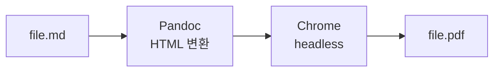
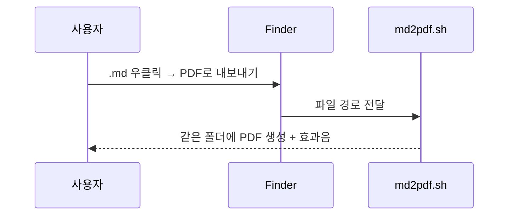

# md-to-pdf 예제 문서

- 작성일: 2026-10-20
- 목적: 이 도구가 지원하는 Markdown 요소를 한 번에 확인
- 형식: **GitHub Flavored Markdown** + Mermaid

---

## 1. 텍스트

한글 문장은 어절 단위로 줄바꿈된다. 긴 문장이 페이지 끝에 닿아도 단어 중간에서 끊기지 않는다. English text and *italic*, **bold**, `inline code`, [링크](https://github.com) 도 섞어 쓸 수 있다.

> 인용문은 이렇게 표시된다.

### 1.1 목록

1. 첫 번째 단계
2. 두 번째 단계
   - 하위 항목 A
   - 하위 항목 B
3. 세 번째 단계 — `0x01`, `0x20` 같은 16진수도 그대로 표시

## 2. 표

| 항목 | 설명 | 비고 |
|---|---|---|
| 변환 엔진 | Pandoc → HTML → Chrome | 약 2초 |
| 본문 폰트 | Pretendard | 한글/영문 |
| 코드 폰트 | JetBrains Mono / D2Coding | 코드 블록은 한글 2칸 폭 |
| 다이어그램 | Mermaid 11 | 오프라인 렌더링 |

## 3. 코드

```python
import json

def load(path: str) -> dict:
    with open(path, encoding="utf-8") as f:
        return json.load(f)
```

```
+------+-----------+---------+
| 헤더 | 길이(u16) | 데이터  |
+------+-----------+---------+
```

## 4. 다이어그램




